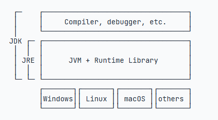

# Java 后端学习笔记

> 用途：边学边记。路线规划在 `Java后端学习路线.md`（打卡表也在那），本文件只放**你真正学到的内容**：概念、代码、踩坑、面试题。
> 用法：每天学完，把当天的要点复制到对应阶段的「笔记区」，或直接告诉 WorkBuddy「把 xxx 记到笔记里」，我来帮你填。
> 约定：代码块用 `java` 标注；面试题单独攒到第五节，方便冲刺期背。

---

## 0. 速记区（随手记，不拘格式）

- 2026-10-28：环境搭好（IDEA + JDK21 + Maven），`learning` 工程能编译运行。Maven 标准目录：源码在 `src/main/java`，测试在 `src/test/java`，编译产物在 `target/`（可删）。

---

## 1. 阶段 1 · Java SE 核心

### 1.0 JDK / JRE / JVM（环境基础）

- **JDK 包含 JRE（含 Java 虚拟机 JVM）以及编译器、调试器等开发工具**。三者是包含关系：JDK ⊃ JRE ⊃ JVM。
  - **JVM**：Java 虚拟机，负责运行字节码（.class），实现"一次编译，到处运行"。
  - **JRE** = JVM + 运行时类库（Runtime Library），只能**运行**程序。
  - **JDK** = JRE + 开发工具（编译器 javac、调试器等），能**开发 + 运行**。
  - 底层 JVM 按操作系统有不同实现（Windows / Linux / macOS 等），所以同一份字节码各平台都能跑。

  

  - 易错/面试点：只装 JRE 能跑 Java 程序但**不能编译**；开发必须装 JDK。我们装的 JDK 21 在 `F:/实习/jdk-21`。

### 1.1 基础语法（变量/类型/运算符/流程控制）

> 模板：概念一句话 + 关键代码 + 易错点

- **变量与类型**（示例，照这个格式记）
  - 八种基本类型：`byte short int long float double char boolean`
  - `int` 4 字节、`long` 加 `L`、`double` 默认浮点、`float` 加 `f`
  ```java
  int a = 10;
  long b = 10L;
  double c = 3.14;
  boolean flag = true;
  ```
  - 易错：`==` 比基本类型值，比对象要比内容（如 `String` 用 `.equals`）

- **基本数据类型**（共 8 种，牢记分组）
  - 整数：`byte`、`short`、`int`、`long`
  - 浮点：`float`、`double`
  - 字符：`char`
  - 布尔：`boolean`
  - 记忆：4 整数 + 2 浮点 + 1 字符 + 1 布尔

- **Java 内置的核心类**（不需要 import，直接用）
  - `Object`：所有类的祖宗，一切类默认继承它（面试常考 `equals`/`hashCode`/`toString`）
  - `String`：字符串（不可变）
  - `StringBuilder` / `StringBuffer`：可变字符串（后者线程安全）
  - `Math`：数学计算，`Math.random()`、`Math.max(a, b)`
  - `System`：`System.out.println` 就来自它
  - `Integer / Double / Character / Boolean`…：8 个基本类型对应的**包装类**（基本类型 ↔ 对象互转、用于泛型）
  - `Class`：反射用（运行时获取类信息）
  - `Thread`：多线程
  - `Exception / RuntimeException`：异常类

- **常用内置包（都需要 `import` 导入）**
  - `java.util`（工具包，超级常用）：集合、日期、随机数
    - `ArrayList`、`HashMap`、`HashSet`、`Random`、`Date`、`Scanner`（控制台输入）
    ```java
    import java.util.Scanner;
    Scanner sc = new Scanner(System.in);
    ```
  - `java.io`（文件、读写数据流）：`File`、`FileInputStream`、`BufferedReader`，读写本地文件
  - `java.math`（高精度数字）：`BigDecimal`（精确小数，财务计算）、`BigInteger`（超大整数）
  - `java.net`（网络）：`Socket`、`URL`，写网络请求
  - `java.nio`（新版文件 IO，NIO）：高性能文件操作，后面才学

- **流程控制：`break` / `continue`（循环里用）**
  - `break` 语句可以**跳出当前循环**（提前结束整个循环）。
    - 通常配合 `if`，在满足条件时提前结束整个循环。
    - `break` **总是跳出最近的一层循环**（嵌套循环时只退出内层）。
  - `continue` 语句可以**提前结束本次循环**（跳过本次剩余代码，进入下一次迭代）。
    - 通常配合 `if`，在满足条件时提前结束本次循环。
  ```java
  for (int i = 0; i < 10; i++) {
      if (i == 3) continue;   // i==3 这次跳过，继续 i==4
      if (i == 8) break;      // 整个循环在 i==8 时结束
      System.out.println(i);    // 输出 0 1 2 4 5 6 7
  }
  ```
  - 易错：嵌套循环里 `break` 只跳一层；要跳多层可用**带标签的 `break`**（如 `outer:` + `break outer;`）。

- **`==` vs `equals()`（面试题常客，重点记）**
  - **`==`**：比较**两个变量里存的地址（引用）是不是同一个**，即是否指向堆里同一个对象。
    - 比基本类型：比的是"值"是否相等。
    - 比引用类型：比的是"内存地址/引用"是否同一个对象。
  - **`equals()`**：`Object` 类默认实现也是比较地址（跟 `==` 效果一样）；**很多类（如 `String`）重写了它，用来比较对象里面的"内容"是否一样**。
  - 易错/结论：比较两个字符串内容是否相等必须用 `str1.equals(str2)`，**不能用 `==`**（除非是同一个对象或字符串常量池命中）。
  ```java
  String a = new String("hello");
  String b = new String("hello");
  a == b;          // false：两个不同对象，地址不同
  a.equals(b);     // true：内容相同（String 重写了 equals）
  ```

### 1.2 数组 / 字符串 / 集合（List/Set/Map）

-

### 1.3 面向对象（类/继承/多态/接口/抽象类）

- **`this` 变量（指向当前实例）**
  - 在方法内部，可以使用一个隐含的变量 `this`，它**始终指向当前实例**（即调用该方法的那个对象）。
  - 通过 `this.field` 可以访问当前实例的字段（成员变量），常用于区分**同名的参数/局部变量**与成员变量。
  ```java
  public class Person {
      private String name;
      public void setName(String name) {
          this.name = name;   // this.name 是成员变量，右边的 name 是参数
      }
  }
  ```
  - 易错/记忆：`this` 只能在**实例方法**和**构造器**里用；**静态方法（static）里没有 `this`**（静态方法不依赖实例）。

- **包（package）与文件命名规则**
  - Java 规定：**一个包下，类名不能重名**。
  - 若声明为 `public class 类名`，则**文件名必须和这个类名完全一模一样**（大小写、下划线都不能差），否则编译报错。
  - 记忆：非 public 的类文件名可不同，但 `public` 类必须与文件名一致。

- **继承（inheritance，强大的代码复用方式）**
  - 继承是面向对象编程的一种强大的**代码复用**方式：子类自动获得父类的字段和方法。
  - **Java 只允许单继承**（一个类只能有一个直接父类，可多层继承）；所有类最终的**根类都是 `Object`**（不写 `extends` 也默认继承它）。
  - `protected` 修饰的成员**允许子类访问**父类的字段和方法（也允许同包其他类访问）。
  - 子类的构造方法可以通过 **`super()`** 调用父类的构造方法（必须写在构造器第一行）。
  - **向上转型（upcasting，安全）**：子类对象可以安全地赋值给更抽象的类型（父类/接口），自动进行。
    ```java
    Person p = new Student();   // Student 是 Person 的子类，安全
    ```
  - **向下转型（downcasting，强制）**：把父类引用转回子类，**最好先用 `instanceof` 判断**，否则类型不符会抛 `ClassCastException`。
    ```java
    if (p instanceof Student s) {   // Java 16+ 模式匹配，安全向下转型
        s.study();
    }
    ```
  - **is-a vs has-a**：子类与父类是 **is 关系**（学生 is a 人）才能用继承；若是 **has 关系**（人 has 一个地址）应当用组合/字段，**不能用继承**。

- **方法覆写（Override，子类改变父类行为）**
  - 子类可以**覆写（Override）**父类的方法，在子类中**改变父类方法的行为**（方法签名必须一致：`@Override` 注解可帮编译器检查）。
  - 覆写常用于：扩展/修正父类逻辑、实现多态。

- **多态（Polymorphism）**
  - Java 的方法调用**总是作用于运行期对象的实际类型**，这种"实际类型决定调用哪个方法"的行为称为**多态**。
  - 结合向上转型：`Person p = new Student(); p.run();` 实际调用的是 `Student.run()`（运行期类型），而非 `Person.run()`。
  - 多态的要件：**继承 + 覆写 + 向上转型**；好处是扩展性好（新增子类无需改调用方代码）。

- **`final` 修饰符（多种作用）**
  - `final` 修饰**方法** → 阻止该方法被覆写（子类不能改）。
  - `final` 修饰 **class** → 阻止该类被继承（如 `String` 就是 final 类）。
  - `final` 修饰 **field（字段）** → 必须在**创建对象时初始化**（声明时或构造器里），之后**不可修改**（即常量）。
  - 记忆口诀：final = "定死"——方法定死不可改、类定死不可继承、字段定死不可变。

- **抽象类与抽象方法（abstract）**
  - 用 `abstract` 定义的方法是**抽象方法**：**只有定义，没有实现**（无方法体 `{}`）。
  - 抽象方法定义了**子类必须实现的接口规范**（相当于"契约"）。
  - **包含抽象方法的 class 必须被声明为抽象类（`abstract class`）**。
  - 从抽象类继承的子类**必须实现（覆写）所有抽象方法**；如果**不实现**，则该子类**仍必须声明为抽象类**。
  - **面向抽象编程**：调用方只关心抽象方法的定义，不关心子类的具体实现——解耦、易扩展（依赖抽象而非具体）。
  ```java
  abstract class Animal {
      abstract void sound();     // 抽象方法：子类必须实现
  }
  class Dog extends Animal {
      void sound() { System.out.println("汪汪"); }   // 必须实现，否则 Dog 也要 abstract
  }
  ```

- **静态字段与静态方法（static）**
  - **静态字段（`static` field）**：属于**所有实例"共享"**的字段，实际上是属于 **class** 的字段（不属于某个对象），一处修改所有实例都看得到。
    ```java
    class Person {
        static int count = 0;   // 所有 Person 实例共享，存在 class 上
    }
    ```
  - **静态方法（`static` method）**：调用**不需要实例**；方法内**无法访问 `this`**（没有当前实例），但可以访问**静态字段**和**其他静态方法**。
  - 静态方法常用于**工具类**和辅助方法（如 `Math.max()`、`Arrays.sort()`）。
  - 调用静态方法**直接用类名**：`Math.max(a, b)`、`Person.count`，无需 `new`。
  - 记忆：`static` = 属于"类级别"，与具体对象无关；实例方法能用 `this`、能访问实例字段和静态字段，静态方法则不能访问实例成员。

- **访问权限与作用域（封装原则）**
  - Java 内建的访问权限共 **4 种**：`public` / `protected` / `private` / **package 权限**（不写修饰符，默认同包可见）。
  - **封装原则**：如果不确定是否需要 `public`，就**不要声明为 `public`**——尽可能少地暴露对外的字段和方法（最小暴露）。
  - **package 权限的妙用**：把方法定义为 package 权限有助于**测试**——只要测试类和被测试类位于**同一个 package**，测试代码就能访问被测试类的 package 权限方法（无需为了测试改 public）。
  - **局部变量**：在**方法内部定义的变量是局部变量**，作用域从声明开始、到**所在块（`{}`）结束**。
  - **`.java` 文件规则**：**一个 `.java` 文件只能包含一个 `public` 类，但可以包含多个非 public 类**；若有 `public` 类，**文件名必须和该 public 类名完全相同**（与前面的"包与文件命名规则"一致）。
  - 澄清：**`final` 不是访问权限**，它可修饰 class / field / method（见上文 `final` 修饰符）。
  - 速记：4 种权限（public/protected/private/package）+ 局部变量块级作用域 + 一个文件一个 public 类 + final 非权限。

### 1.4 异常 / 泛型 / IO / 反射 / 注解

-

### 1.5 Lambda / Stream API

-

### 1.6 并发基础（线程/synchronized/线程池/JMM）

-

### 1.7 JVM 基础（内存结构/GC）

-

### 1.8 设计模式（单例/工厂/策略）

-

---

## 2. 阶段 2 · 数据库与工具

### 2.1 MySQL（SQL/索引/事务/锁/优化）

-

### 2.2 Redis（结构/持久化/缓存问题/分布式锁）

-

### 2.3 Git / Maven / Linux 常用

-

---

## 3. 阶段 3 · Spring Boot

### 3.1 IoC/DI / 自动配置 / 起步依赖

-

### 3.2 Spring MVC（Controller/Service/Mapper 分层）

-

### 3.3 MyBatis / MyBatis-Plus

-

### 3.4 AOP / 拦截器 / JWT / 全局异常处理

-

### 3.5 八股专题（循环依赖/Bean 作用域/事务失效）

-

---

## 4. 阶段 4 · 项目实战

### 4.1 项目 A：博客/待办后端（架构/ER 图/关键点）

-

### 4.2 项目 B：接入大模型的智能后端（API 调用/REST 暴露）

-

---

## 5. 面试题积累（冲刺期背这个）

> 格式：`问题 ｜ 我的答案要点 ｜ 参考`

- Q：Java 基本类型 vs 包装类？ ｜ 基本类型在栈、默认值明确；包装类有方法、可用于泛型；自动装箱拆箱有性能/空指针隐患 ｜ 《Java 核心技术》
-

---

## 6. 错题 / 踩坑本

> 格式：`现象 ｜ 原因 ｜ 解决`

- 现象：Maven 构建说找不到 JDK ｜ 原因：PATH 里旧 JDK8 在前 ｜ 解决：把 JDK21 的 bin 前置到 PATH，或显式设 `JAVA_HOME`
-

---

> 提示：`target/`、`.idea/`、`*.iml` 是自动生成的，不要往笔记外的事上纠结；笔记只记"人话理解的干货"。
